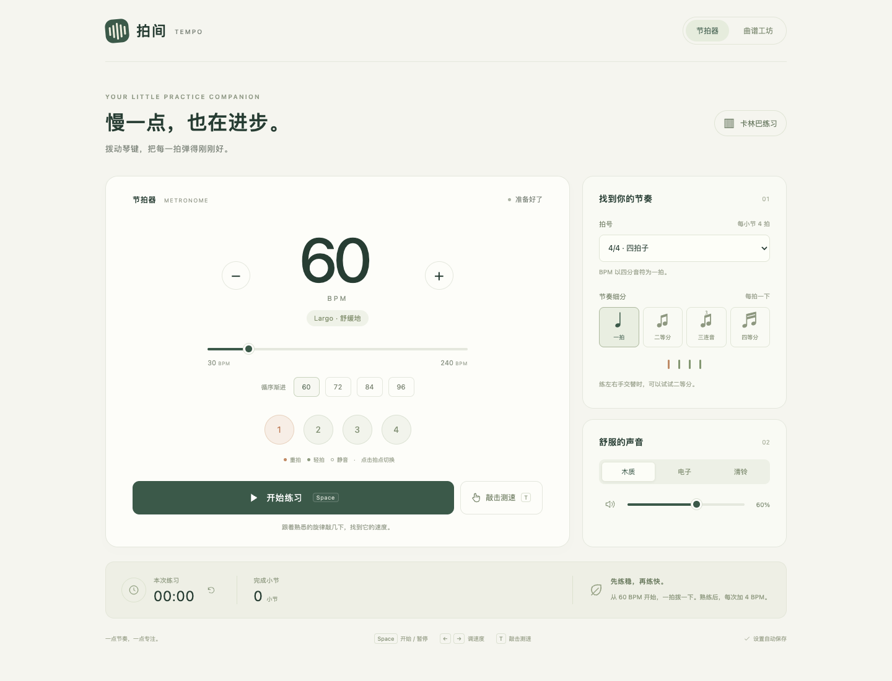
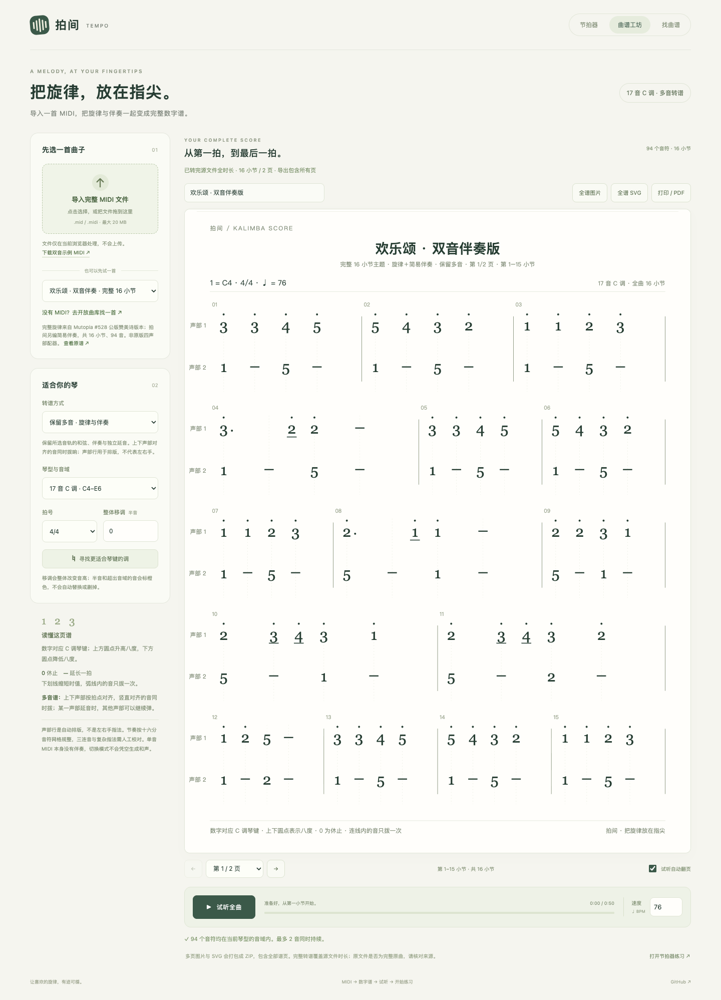

# 拍间 · 卡林巴练习工具

一个卡林巴练习工具，提供节拍器、MIDI 数字谱工坊和练琴打卡，使用原生 HTML、CSS、JavaScript 和 Web Audio API。节拍器与本地制谱无需账户、可离线使用；练琴打卡需要联网并开通账号服务。

**在线使用：[打开拍间节拍器](https://line-ar-line.github.io/paijian-metronome/)**

**曲谱工坊：[MIDI 转卡林巴数字谱](https://line-ar-line.github.io/paijian-metronome/score.html)**

**内置曲库：[浏览 1,000 份完整来源曲谱](https://line-ar-line.github.io/paijian-metronome/library.html)**，支持曲名及作曲家搜索、编制与多音筛选、原调音域覆盖率排序，点击即可打开数字谱，也可下载原始 MIDI。另保留 Mutopia、PDMX、Lakh、MAESTRO、GiantMIDI 的扩展入口。

用电脑或手机浏览器打开链接，点击“开始练习”即可。可以直接把这个地址分享给朋友，无需登录 GitHub。



## 1,000 份内置曲谱

曲库内置 1,000 个不同 Mutopia 官方条目的原始主 MIDI 文件，合计 **9.67 MB**，覆盖 **209 位作曲者**；其中 **908 份 Public Domain、69 份 CC BY 4.0、23 份 CC BY 3.0**。曲目标题、作曲家、编谱者、原编制、来源页、许可证版本、完整字节校验值及音符统计均随项目保存。按来源条目及独立乐章收录，不截取文件，不以分声部练习文件或重复音乐内容补足数量。文件完整不等于整部多乐章作品；具体范围以原标题、作品编号和来源说明为准。

优先收录 Public Domain，其余采用 CC BY 允许再分发的曲目。每条曲目的署名和精确许可见 [目录索引](catalog/index.json)；原始 MIDI 字节保持不变。生成的 SVG、PNG 和打印页也保留来源、许可与转换说明。详细筛选和验证记录见 [曲库说明](catalog/README.md) 与 [构建报告](catalog/build-report.json)。

这些是可完整转谱的原始作品，包含钢琴、合唱、弦乐等编制，并非 1,000 份已经人工改编好的 17 音 C 调成品谱。目录的“C17 原调覆盖”表示源音符落在琴键音域内的比例，不代表复杂和弦或指法可以原样演奏；可在工坊移调、选择音轨或切换单音练习。

目录每页显示 24 条，只加载元数据；打开某首曲子时才读取对应 MIDI。曲目链接格式为 `score.html?piece=mutopia-编号`，可直接分享。在线网站和本地 HTTP 服务支持自动载入；直接以 `file://` 打开文件时，目录仍可浏览，可下载 MIDI 再手动导入。

用 `node tools/build-catalog.cjs` 可以重建曲库。构建器缓存来源下载，逐个检查 MIDI、完整多音转换和试听兼容性，并按来源 ID、字节、移调归一化的音乐事件和作品身份去重；不满足目标时停止，不发布部分结果。

## MIDI 数字谱工坊

导入完整的 `.mid` / `.midi` 文件，保留旋律、伴奏、和弦及各自延音，即可生成完整的多声部数字谱。也可切换为单音简化。默认是 **17 音 C 调**，也可切换为 21 音 C 调。首页默认展示《欢乐颂》双音伴奏版（完整 16 小节、94 音）。另有完整的《小星星》12 小节、《欢乐颂》16 小节主题和原创《指尖小练习》4 小节；也可下载 [小星星 MIDI](examples/twinkle.mid) 或 [欢乐颂完整主题 MIDI](examples/ode.mid) 体验导入。

[直接打开《欢乐颂》完整版](https://line-ar-line.github.io/paijian-metronome/score.html?example=ode)。该编配逐音对应 Mutopia 第 528 号公版赞美诗版本的完整高声部，包含中段与再现，共 **62 个音、16 小节、64 拍**。来源、原始完整 MIDI 和完整 LilyPond 原谱见 [sources/README.md](sources/README.md)。

[直接打开《欢乐颂》双音伴奏版](https://line-ar-line.github.io/paijian-metronome/score.html?example=ode-duet) · [下载双声部 MIDI](examples/ode-duet.mid)。保留上述全部 62 个旋律音，另编 32 个伴奏音，共 64 拍，最多两音同时持续；所有音高均位于 17 音 C 调音域。这是拍间的新编简易伴奏，不是原谱的四声部配器。

生成结果示例：[小星星数字谱 PNG](examples/twinkle-score.png) · [SVG](examples/twinkle-score.svg)；[欢乐颂完整主题 PNG](examples/ode-score.png) · [SVG](examples/ode-score.svg)。



1. 打开 `score.html` 或在线曲谱工坊，选择或拖入 MIDI 文件。
2. 默认“保留多音”，多轨文件自动合并所有非鼓声音轨；也可选择单条音轨练习。选择“单音简化”可以只保留同一拍的最高音。
3. 多音谱上下声部按拍点对齐，对齐的数字同时拨响，各声部的休止、时值与延音独立。声部行是自动排版，不代表原 MIDI 乐器声部或左右手指法。选择琴型、拍号和整体移调。点击“寻找更适合琴键的调”，可以寻找能覆盖更多音符的移调方案。此操作会整体改变旋律的实际音高。
4. 点击“播放 / 暂停”控制音频，暂停后保留位置；拖动进度条跳转，播放中松手继续，暂停时松手只定位。“从头播放”可重新开始。点击谱面任意小节也可从该小节播放，键盘聚焦小节后可按 Enter / 空格。反复段选择当前或下一次出现的位置；后面不再出现时回到首次。
5. 默认开启“播放时自动跟随”：高亮当前小节，自动向下滚动和跨页，窄屏还会左右跟随；可取消勾选后自由浏览。播放控件在滚动时固定于顶部。修改谱面设置会暂停并重置播放位置。
6. “全谱图片”和“全谱 SVG”始终导出所有页；单页直接下载，多页打包为 ZIP。“打印 / PDF”也包含全部谱页，在浏览器对话框中选择保存 PDF。

数字使用固定的 **1 = C4** 琴键对应关系，并保留高低八度圆点、升号、休止符、时值下划线、附点、小节线和延音线。17 音 C 调音域为 C4–E6 的自然音，21 音版为 F3–E6 的自然音。当前琴型没有的半音或超出音域的音会标为橙色，试听保留该音高，不会悄悄替换音符或折叠八度。

### 转谱范围

- 接受标准 MIDI 格式 0 / 1、PPQ 时间单位，文件最大 20 MB；最多 100,000 个输入音符、2048 小节。超限时整份拒绝，不生成部分乐谱。格式 2 和 SMPTE 时间单位会给出明确提示。
- 保留源 MIDI 所有音轨的总时间线，包括开头休止、旋律结束后的其他声部、End-of-Track 结束标记前的尾部休止。分页只改变显示，导出和打印不会丢失后半首。最后一个不完整小节可补休止用于排版，试听按源时长结束。
- 完整文件不等于完整原曲。原文件如果只有主题、单独乐章或选段，程序无法恢复源文件没有提供的部分；请通过原谱、反复段、版本和结尾核对。《欢乐颂》的“完整”明确指来源发布的 16 小节赞美诗主题编配。
- 默认**保留多音**：所选音轨中的所有音符及独立时值都参与转谱，不因后续旋律开始而截掉伴奏。可以合并所有非鼓声音轨。最多支持 64 条同时占用的排版声部，超过上限时拒绝整份转换。
- **单音简化**是可选模式：同一位置的和弦保留最高音，重叠延音截短到下一个音符，并在页面说明；它不自动识别主旋律。
- 保留多音不会为单音 MIDI 自动生成和声。琴键音域能覆盖也不等于双拇指能原样弹奏复杂钢琴配器；密集和弦、同音重叠和指法仍需人工改编。
- 起止时间按十六分音符网格规整；断奏、三连音与自由节奏可能改变，会提示校对。MIDI 踏板延音不参与转换，也会提示。
- 全曲采用一个拍号和均匀的练习速度，初始值来自 MIDI。原文件中途的变拍、变速会显示提示，当前版本不重现完整速度曲线。
- 本地文件只在浏览器内解析，不上传、不保存到 GitHub。导出的谱图下载到当前设备。
- 多页导出使用无依赖的标准 ZIP；完整归档上限为 256 MiB，超限时整份停止，不下载残缺页集。长曲优先使用 SVG 或打印 / PDF。
- 试听采用合成拨弦音，最多 64 音同时持续，超限时整首拒绝播放；和弦保留全部声音，并根据峰值重叠数降低整体增益，避免叠加削波。谱面同时高亮当前发声的所有音符。浏览器严重挂起或音频中断时会停止，保持页面在前台使用更稳妥。

曲谱工坊的主要实现分别位于 `score/midi.js`（解析）、`score/score-model.js`（转谱）、`score/renderer.js`（分页与 SVG 排版）、`score/export.js`（全谱归档）、`score/player.js`（试听）和 `score/workshop.js`（交互）。示例 MIDI 可通过 `node tools/export-examples.cjs` 从内置示例音符重新生成。

## 练琴打卡与邮箱登录

入口：[练琴打卡](https://line-ar-line.github.io/paijian-metronome/community.html) → **打开打卡试用版**。试用页运行于已配置的 CloudBase 上海环境，支持真实邮箱验证码和云端记录。数据库及邮箱服务已配置，真实邮件送达、首次注册和双账户交互仍需用自己的邮箱验收。部署与维护见 [CloudBase 配置说明](docs/CLOUDBASE_SETUP.md)。

- 邮箱验证码登录，首次验证自动注册；账号由 CloudBase Auth 验证，刷新页面可恢复登录状态。
- 每个账号每天打卡一次，填写练习分钟数、曲目和心得；日期统一由服务器按北京时间计算。重复请求返回同一条记录，不重复计数、不覆盖已保存内容。
- 查看连续打卡、累计天数、累计分钟数、本月日历和近 90 天记录。
- 默认仅自己可见。可选择分享到琴友动态和本周坚持榜，也可在自己的历史记录中取消分享。分享的记录显示昵称、曲目、分钟数和心得，不读取或公开账号邮箱。
- 动态显示最新 30 次公开练习；周榜按本周公开打卡天数、练习分钟数排列前 20 位，周一按北京时间重新计榜。时长由用户填写，不代表自动测量的有效练琴时长。
- 数据库拒绝未登录读写、代替其他用户写入、由浏览器指定打卡日期，以及绕过函数直接读写业务表。个人统计包括私密记录，动态和周榜只计算公开记录。

当前 CloudBase 体验套餐不允许添加 `line-ar-line.github.io` 安全域名，实际 API 返回 `OperationDenied.FreePackageDenied`。因此 GitHub 只提供试用入口，登录和打卡在环境自带的 CloudBase 域名完成；此域名按官方规则仅用于开发测试，可能出现访问确认页和频率限制。正式对外开放需要支持自定义安全域名的套餐或更换部署方案，不能把当前试用入口视为永久免费的生产服务。

后端使用 [CloudBase PostgreSQL 脚本](cloudbase/schema.sql)，通过已验证用户的数据库 RPC 保存和读取记录。网页只包含公开环境 ID，不包含管理员密钥。原 [Supabase 配置说明](docs/COMMUNITY_SETUP.md) 和实现保留为备选方案。

登录仅用于练琴打卡与社区；现有曲谱收藏和制谱草稿仍保存在当前浏览器，尚未同步到账户。

验证：`node --test tests/cloudbase-client.test.cjs tests/cloudbase-auth.browser.cjs tests/community.browser.cjs`。前两项核对适配器与官方 SDK 的真实请求格式，浏览器测试使用模拟接口、不发送邮件。PostgreSQL 业务与权限测试见 `tests/cloudbase-db.test.cjs`；PGlite 临时依赖安装及真实账户验收步骤见 [CloudBase 配置说明](docs/CLOUDBASE_SETUP.md)。

## 本地使用

用 Chrome、Edge 或 Safari 打开本文件夹里的 `index.html` 使用节拍器，或打开 `score.html` 使用曲谱工坊。浏览器需要用户点击后才允许播放声音。

也可以在本文件夹执行 `python3 -m http.server 8765 --bind 127.0.0.1`，访问 `http://127.0.0.1:8765`。

## 发布与更新

本项目通过 GitHub Pages 从 `main` 分支根目录发布，不需要构建或部署依赖。修改网页文件后提交并推送到 `main`，GitHub 会自动更新在线页面，通常需要几分钟。

自行 Fork 后，可在仓库的 **Settings → Pages** 中选择 **Deploy from a branch**，再选择 **main / (root)** 并保存。发布完成后，以该页面显示的网址为准。

## 使用

- 速度：30–240 BPM；直接输入、拖动滑块，或使用加减按钮。默认 60 BPM，4/4 拍，木质音色。
- 常用速度：60、72、84、96 BPM。建议先从 60 BPM 一拍拨一次，稳定后每次提高 4 BPM。
- 拍号：2/4、3/4、4/4、6/8。6/8 模式以八分音符为 BPM 单位，显示六个拍点，并把第 1、4 个拍点设为重拍，形成 3 + 3 分组。例如八分音符 180 BPM 对应附点四分音符 60 BPM；第 4 个拍点与第 1 个拍点音色强度相同，可自行切换。
- 细分：每拍一下、二等分、三连音、四等分。卡林巴左右手交替练习可选择二等分：一次点击对应一次拨弦。
- 拍点：点击在“重拍 → 静音 → 轻拍”之间循环。静音拍会把这一拍的细分声一起静音，视觉拍点仍继续运行。
- 敲击测速：跟着旋律点击“敲击测速”，或按 T。连续敲 4–7 次更稳定；间隔超过 2.4 秒会开始新一组。
- 音色：木质、电子、清铃；支持音量调整与一键静音。
- 本次练习：只累计播放期间的时间；暂停后保留。小节数在下一小节第一拍响起时增加，停止前未完整结束的小节不计入。更换拍号或细分时从第一拍重新开始。
- 设置会保存在当前浏览器。浏览器禁止本地存储时仍可使用，只是无法跨页面保留设置。练习计时不会跨刷新保存。

## 快捷键

| 按键 | 功能 |
| --- | --- |
| Space | 开始 / 暂停（焦点在按钮上时，遵循按钮本身的键盘操作） |
| ← / → | 降低 / 提高 1 BPM |
| Shift + ← / → | 降低 / 提高 4 BPM |
| T | 敲击测速 |

编辑输入框或选择拍号时，不触发全局快捷键。

## 实现与限制

`engine.js` 负责使用音频时钟提前调度声音，`app.js` 负责交互、练习计时与设置保存，`styles.css` 负责响应式布局。声音全部本地合成，没有外部音频、字体或网络请求。

声音按 AudioContext 的时间轴安排，页面的定时器仅负责提前补充未来的拍点，不决定声音的实际开始时间。拍点高亮跟随音频时钟；显示帧率、设备音频延迟和蓝牙耳机仍可能造成视听延迟。练习时推荐设备扬声器或有线耳机。

变速会作用于尚未安排的拍点，已提前安排的短段节奏会先完成；更换拍号或细分会清除旧声音，从第一拍重新开始。系统休眠、切换音频设备或浏览器严重暂停调度时，会停止播放并提示重新开始，避免恢复后连续补播。后台播放和手机锁屏播放取决于浏览器及系统；练习时建议保持页面在前台。在支持 Screen Wake Lock 的浏览器中，播放期间会尽量保持屏幕唤醒。

## 验证

音频、MIDI、转谱和谱面测试使用 Node 内置测试工具，无需安装包：

```sh
node --test tests/engine.test.cjs tests/midi.test.cjs tests/score-model.test.cjs tests/score-renderer.test.cjs tests/score-player.test.cjs tests/score-export.test.cjs tests/complete-examples.test.cjs
```

另外提供了 `tests/browser.test.cjs`。开发时安装 Playwright 并准备 Chrome 后，可运行 `node --test tests/browser.test.cjs`，验证实际音频输出、节拍间隔、暂停、快捷键、设置持久化、后台小节计数和窄屏布局。此项验证会更新两张 `preview-*.png` 截图；使用节拍器本身不需要 Playwright 或 Node。

播放交互验证：`node --test tests/playback-navigation.browser.cjs`，覆盖暂停续播、拖动与键盘跳转、点击小节、跨小节延音、反复定位和桌面/手机自动跟随。

曲谱工坊的浏览器集成验证：`node --test tests/workshop.browser.cjs`，使用同样的 Playwright 和 Chrome 环境，覆盖 MIDI 上传、音轨选择、谱面渲染、试听、导出与移动端布局。

完整谱验证：`node --test tests/full-score.browser.cjs`，覆盖 300 小节 MIDI 的最后音符与尾部时间、全页遍历、全部 PNG/SVG ZIP 文件、完整打印、曲库搜索入口及移动端布局。

多音验证：`node --test tests/polyphony.browser.cjs`，覆盖完整双声部示例、独立延音、多轨合并、和弦试听高亮、全页导出和手机布局。

曲库验证：`node --test tests/catalog.test.cjs` 检查全部 1,000 份文件、官方元数据快照、许可证、完整转谱与去重；`node --test tests/catalog.browser.cjs` 检查目录搜索、筛选、分页、下载、深链接载入、导出署名、错误处理及手机布局。


## 收藏、人工编配与制谱

- `score.html?score=heixiu-rhapsody`：用户提供《嘿咻狂想曲》的完整人工录入谱，29 个谱面小节、两个原声部、12 处滑音；13–20 小节反复一次，试听 37 小节。原图可以展开对照，JSON 可以下载或打开可编辑副本。
- 曲库与已发布曲谱页支持收藏；`library.html?favorites=1` 只看收藏。收藏在当前浏览器保存，不会自动同步其他设备。
- `composer.html`：1–4 声部手写数字谱、和弦、向上滑音、反复、实时预览与试听，支持草稿自动保存、JSON 导入/导出、全谱 SVG 导出。草稿保存在当前浏览器，存储失败会显示提示；建议导出 JSON 备份。
- 长期公开保存：导出 JSON，再执行 `node tools/add-score.cjs 曲谱.json my-song`，将生成的曲谱和目录变更提交到 `main`。GitHub Pages 部署后即可通过固定链接跨设备访问。详见 [发布说明](scores/README.md)。静态网页不持有 GitHub 写凭据，也不会把本地草稿误报成已上传。

验证：`node --test tests/document.test.cjs tests/user-library.test.cjs tests/composer-storage.test.cjs`；浏览器验证为 `tests/composer.test.cjs` 和 `tests/favorites.browser.cjs`（需要 Playwright 与 Chrome）。
